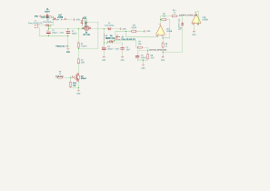

# Smart Battery Charger

A KiCad 10 project for a PWM-controlled buck charging stage with voltage and current sensing. The repository contains the editable schematic and PCB layout.

> **Project status:** Hardware design / prototype. Battery chemistry, charging profile, input voltage range, output current, and controller firmware are not specified in this repository. Review and validate the complete system before connecting a battery.

## Design at a glance

| Block | Parts / signals | Purpose |
| --- | --- | --- |
| Power input | `J1` | Two-pin input terminal |
| Buck stage | `Q1` IRF7404, `L1` 33 µH, Schottky diodes | Switching power path |
| Current sensing | `R9` 0.02 Ω, `U1` LM358, `CURRENT_SENSE_ADC` | Current measurement signal |
| Voltage sensing | `VOLTAGE_SENSE_ADC` | Output voltage measurement signal |
| Control | `PWM_OUT`, `Q2` BC847 | PWM-driven switching control |
| Battery/output | `J2` | Two-pin output terminal |

The ADC and PWM names are **schematic labels**, not a documented external connector interface. In particular, KiCad reports that `PWM_OUT` is connected to only one schematic pin. Integrating a controller requires checking the actual PCB connections and adding a suitable physical interface as needed.

## Previews

### Schematic

### PCB front

## Open the project

1. Install [KiCad](https://www.kicad.org/) 10 or newer.
2. Open `Smartbattrycharger.kicad_pro` in KiCad Project Manager.
3. Open the schematic and PCB from the project window. Review footprints, component ratings, and design rules before fabrication.

## Repository files

- `Smartbattrycharger.kicad_pro` — KiCad project settings
- `Smartbattrycharger.kicad_sch` — editable schematic
- `Smartbattrycharger.kicad_pcb` — editable PCB layout
- `images/` — exported SVG previews for GitHub

## Design checks

Checked with **KiCad CLI 10.0.6**:

- PCB DRC: **0 violations, 0 unconnected items**.
- Schematic ERC: **1 warning** — `PWM_OUT` is an isolated pin label.

These automated checks do not establish electrical safety or suitability for a particular battery. Confirm the power supply, charging algorithm, thermal performance, and protection requirements for the intended use.

## License

No license has been selected yet. Please contact the repository owner before reusing the design beyond what GitHub's default terms allow.
